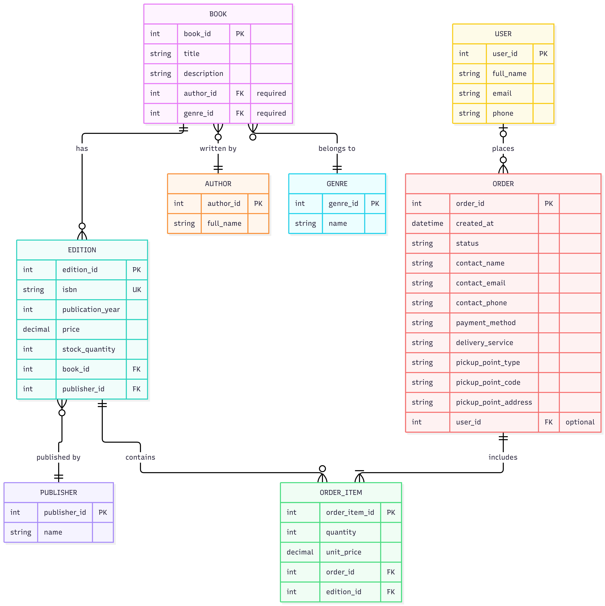

# ER-модель книжкового магазину

## Опис
ER-діаграма представляє основні сутності онлайн-магазину друкованих книг, їхні атрибути та зв'язки між ними. Модель охоплює каталог книг, окремі видання, інформацію про авторів, жанри, видавництва, користувачів та замовлення.

## Діаграма

[Вихідний код Mermaid](er-model.mmd)

## Основні сутності
- **BOOK** — інформація про книгу, її назву, опис, автора та жанр.
- **AUTHOR** — інформація про автора книги.
- **GENRE** — жанри, за якими класифікуються книги.
- **EDITION** — окремі видання книг з ISBN, роком випуску, ціною та кількістю на складі.
- **PUBLISHER** — видавництва книг.
- **USER** — зареєстровані користувачі магазину.
- **ORDER** — замовлення, контактні дані покупця, спосіб оплати та доставки.
- **ORDER_ITEM** — окремі позиції замовлення із зазначенням кількості та ціни.

## Зв'язки між сутностями
- Один автор може мати багато книг, але кожна книга має одного автора.
- Один жанр може включати багато книг, але кожна книга має один основний жанр.
- Одна книга може мати декілька видань.
- Одне видавництво може випускати багато видань.
- Користувач може оформлювати декілька замовлень. Також підтримуються замовлення без реєстрації.
- Одне замовлення може містити декілька позицій.
- Одне видання може зустрічатися в різних замовленнях.

## Ключі
У діаграмі використовуються позначення:
- **PK** — первинний ключ.
- **FK** — зовнішній ключ.
- **UK** — унікальний ключ.

## Основні правила
- Магазин продає лише друковані книги.
- Книга може мати декілька видань із різними характеристиками.
- Кожне видання має власну ціну та складські залишки.
- Замовлення можна оформити без реєстрації.
- Оформлене замовлення повинно містити хоча б одну позицію.
- Кількість замовлених примірників не повинна перевищувати доступний залишок.
- Ціна товару не може бути від'ємною.

## Висновок
Модель містить 8 основних сутностей і відображає структуру даних книжкового магазину. Її можна використовувати як основу для наступних лабораторних робіт.
