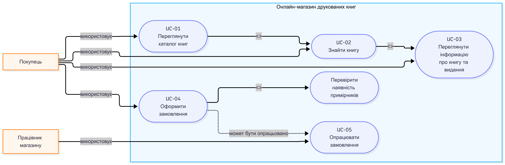

# Use Case-діаграма онлайн-книжкового магазину

## Опис

Діаграма відображає взаємодію покупця та працівника магазину з інформаційною системою онлайн-продажу друкованих книг. Вона є продовженням ER-моделі Завдання №1 і показує основні цілі користувачів, а не послідовність дій чи структуру бази даних.

## Діаграма

[Вихідний код Mermaid](LilG3ra/MAVPZ/blob/main/task-2-requirements-use-case/diagrams/UC.mmd)

[Відкрити Mermaid Live](https://mermaid.live/)

## Основні актори

- **Покупець** — переглядає каталог, шукає книги, отримує інформацію про видання та оформлює замовлення без обов'язкової реєстрації.
- **Працівник магазину** — переглядає та опрацьовує оформлені замовлення.

## Основні сценарії використання

- **UC-01** — Переглянути каталог книг.
- **UC-02** — Знайти книгу.
- **UC-03** — Переглянути інформацію про книгу та видання.
- **UC-04** — Оформити замовлення.
- **UC-05** — Опрацювати замовлення.

## Зв'язки між сценаріями

- Покупець пов'язаний із UC-01, UC-02, UC-03 та UC-04.
- Працівник магазину пов'язаний із UC-05.
- UC-04 має обов'язкову залежність `include` від сценарію "Перевірити наявність примірників".
- UC-01–UC-03 не з'єднані стрілками між собою: діаграма не задає послідовність перегляду чи пошуку.
- UC-05 не має `include` або `extend` з UC-04: опрацювання замовлення є окремою ціллю працівника.

## Основні бізнес-правила

- Замовлення можна оформити без реєстрації.
- Одна книга може мати декілька видань; кожна позиція замовлення стосується конкретного `EDITION`.
- Замовлення містить щонайменше одну позицію `ORDER_ITEM`.
- Замовлена кількість не може перевищувати доступний залишок видання.
- Ціна видання фіксується на момент оформлення замовлення.

## Висновок

Use Case-діаграма описує п'ять основних цілей двох акторів і обов'язкову перевірку залишків під час оформлення замовлення. Вона узгоджена з предметною областю Завдання №1 та є основою для сценаріїв Gherkin, вимог EARS і матриці трасування.
