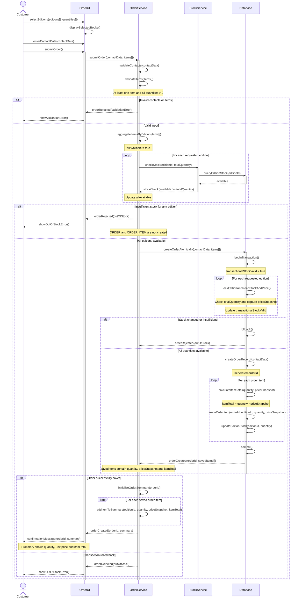

# Sequence Diagram — SC-01 Успішне оформлення замовлення

## Опис

Ця діаграма деталізує успішне оформлення замовлення в онлайн-магазині друкованих книг (UC-04 із Завдання №2). Вона показує взаємодію покупця, інтерфейсу, сервісів і сховища даних: від надсилання замовлення до підтвердження, включно з перевіркою даних і залишків, транзакційним збереженням, фіксацією ціни та розрахунком вартості позицій.

## Діаграма

[Вихідний код Mermaid](https://github.com/LilG3ra/MAVPZ/blob/main/task-3-sequence-diagram/diagrams/SC-01.mmd)

[Відкрити Mermaid Live](https://mermaid.live/)

[Матриця трасування](../traceability.md)

## Основні учасники

- **Customer** — обирає видання, зазначає кількість, вводить контактні дані та підтверджує замовлення.
- **OrderUI** — приймає дані й показує результат оформлення та підсумок замовлення.
- **OrderService** — перевіряє дані, координує перевірку залишків і створення замовлення, формує підсумок із збережених позицій.
- **StockService** — перевіряє доступні залишки обраних видань.
- **Database** — надає інформацію про видання, транзакційно створює замовлення та позиції, фіксує ціни, обчислює вартість позицій і оновлює залишки.

## Основні кроки взаємодії

- Покупець обирає видання та кількість, заповнює контакти й надсилає замовлення.
- OrderService виконує validateContacts() і validateItems(): замовлення містить щонайменше одну позицію, кількість кожної позиції додатна.
- OrderService групує позиції за виданням і через StockService перевіряє достатність залишків.
- Database розпочинає транзакцію, блокує відповідні видання, повторно перевіряє залишки й фіксує актуальну ціну як priceSnapshot.
- Database створює ORDER та пов'язані ORDER_ITEM, обчислює itemTotal = quantity * priceSnapshot, оновлює залишки й виконує commit(); якщо залишку недостатньо, виконує rollback().
- Після успішного збереження Database повертає OrderService ідентифікатор замовлення та savedItems[] із кількістю, ціною та вартістю позицій.
- OrderService формує summary через initializeOrderSummary() та addItemToSummary(), після чого OrderUI показує покупцеві підтвердження з кількістю, ціною одиниці й сумою позиції.

## Зв'язки між учасниками

- Customer взаємодіє з OrderUI, а не безпосередньо з базою даних.
- OrderUI передає запит до OrderService.
- OrderService звертається до StockService, а StockService читає залишки з Database.
- Створення ORDER і ORDER_ITEM, обчислення вартості позицій та оновлення залишків виконуються в межах транзакції Database.
- Формування підсумку замовлення належить OrderService, який використовує збережені дані після успішного commit().
- Фрагменти loop моделюють обробку видань і позицій, а alt — успішні та помилкові результати перевірок.

## Основні бізнес-правила

- Замовлення можна оформити без обов'язкової реєстрації.
- Замовлення повинно містити щонайменше одну позицію, а кількість кожної позиції має бути більшою за нуль.
- Кожна позиція ORDER_ITEM стосується конкретного EDITION і пов'язана з ORDER через orderId.
- Сумарна замовлена кількість одного видання не може перевищувати доступний залишок.
- Ціна одиниці фіксується як priceSnapshot на момент оформлення; вартість позиції дорівнює quantity * priceSnapshot (FR-14).
- У разі rollback() замовлення не повинно зберігатися частково.

## Висновок

SC-01 деталізує успішний шлях UC-04, включно з перевіркою даних та залишків, атомарним створенням ORDER і ORDER_ITEM, фіксацією ціни, обчисленням вартості позицій і формуванням підтвердження. Помилкові сценарії окремо деталізовано в SC-02–SC-04.
