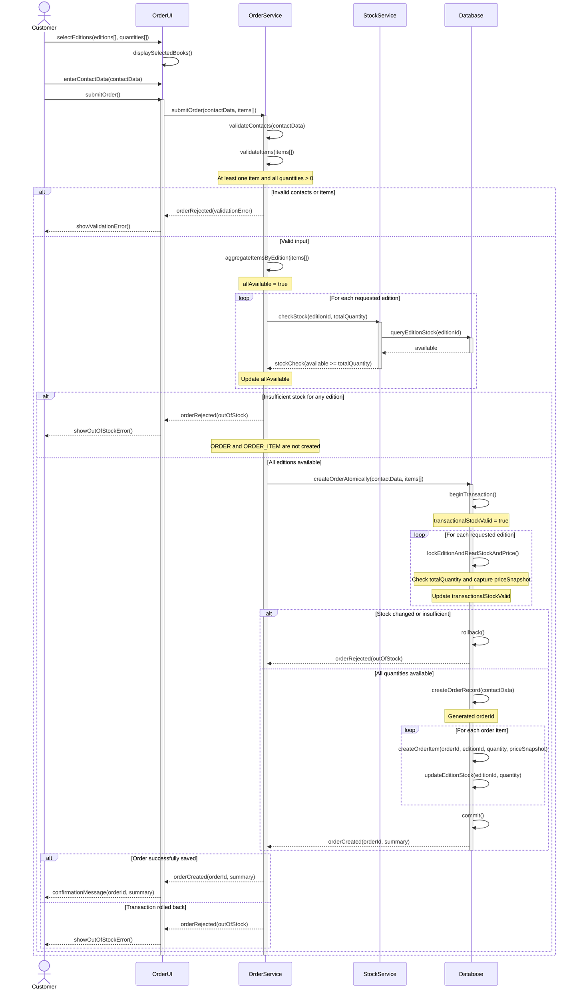

# Sequence Diagram — SC-01 Успішне оформлення замовлення

## Опис

Ця діаграма деталізує успішне оформлення замовлення в онлайн-магазині друкованих книг (UC-04 із Завдання №2). Вона показує взаємодію покупця, інтерфейсу, сервісів та сховища даних, а саме: від надсилання замовлення до підтвердження, включно з перевіркою даних, залишків видань і фіксацією ціни.

## Діаграма

[Вихідний код Mermaid](https://github.com/LilG3ra/MAVPZ/blob/main/task-3-sequence-diagram/diagrams/SC-01.mmd)

[Відкрити Mermaid](https://mermaid.live/)

[Матриця трасування](../traceability.md) - ще не готово

## Основні учасники

- Customer — обирає видання, зазначає кількість, вводить контактні дані та підтверджує замовлення.
- OrderUI — приймає дані та показує результат оформлення.
- OrderService — перевіряє замовлення, координує перевірку залишків і створення записів.
- StockService — перевіряє доступний залишок вибраного видання.
- Database — надає дані про видання та виконує транзакційне збереження замовлення, його позицій і змін залишків.

## Основні кроки взаємодії

- Покупець обирає видання та вказує кількість, заповнює контакти й надсилає замовлення.
- OrderService виконує validateContacts() і validateItems(): замовлення має містити хоча б одну позицію, а кількість кожної позиції має бути додатною.
- OrderService групує однакові видання та через StockService перевіряє, чи достатньо примірників для всіх позицій.
- За успішної перевірки Database починає транзакцію, повторно перевіряє залишки та зчитує актуальні ціни видань.
- Database створює ORDER, пов’язані ORDER_ITEM з orderId та priceSnapshot, оновлює залишки й завершує транзакцію.
- OrderService передає результат інтерфейсу, який показує покупцеві підтвердження.

## Зв'язки між учасниками

- Customer взаємодіє з OrderUI, а не з самою базою даних.
- OrderUI передає запит на оформлення до OrderService.
- OrderService звертається до StockService, а StockService до Database.
- Створення ORDER і ORDER_ITEM та оновлення залишків показані всередині однієї транзакції.
- Фрагменти loop моделюють обробку кожного видання й позиції, а фрагменти alt — успішні та помилкові результати перевірок.

## Основні бізнес-правила

- Замовлення можна оформлювати без обов’язкової реєстрації.
- У замовленні має бути щонайменше одна позиція, а її кількість повинна бути більшою за нуль.
- Кожна позиція ORDER_ITEM стосується конкретного EDITION та пов’язана із замовленням ORDER через orderId.
- Сумарна замовлена кількість одного видання не повинна перевищувати залишок.
- Ціна фіксується як priceSnapshot на момент оформлення.
- У разі відхилення транзакції замовлення не повинно зберігатися частково.

## Висновок

Діаграма деталізує успішний шлях UC-04 та враховує перевірку даних, залишків, створення ORDER і ORDER_ITEM і фіксацію ціни. Альтернативні помилкові сценарії деталізовані окремо в SC-02 - SC-04.
