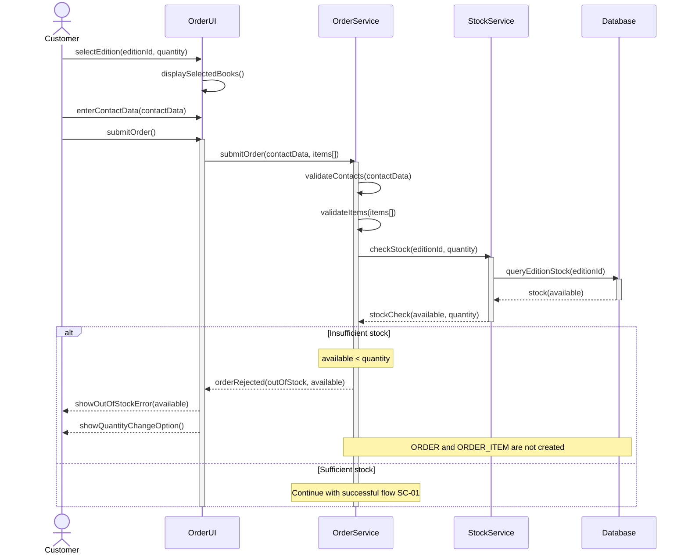

# Sequence Diagram — SC-02 Недостатній залишок

## Опис

Діаграма показує помилковий сценарій UC-04 із Завдання №2, коли покупець замовляє більше примірників видання, ніж доступно. Система перевіряє залишок, повідомляє фактичну доступну кількість і пропонує змінити кількість без створення замовлення.

## Діаграма

[Вихідний код Mermaid](https://github.com/LilG3ra/MAVPZ/blob/main/task-3-sequence-diagram/diagrams/SC-02.mmd)

[Відкрити Mermaid Live](https://mermaid.live/)

[Матриця трасування](../traceability.md)

## Основні учасники

- **Customer** — обирає видання, вводить дані та намагається оформити замовлення.
- **OrderUI** — отримує запит покупця, повідомляє доступну кількість і показує можливість її змінити.
- **OrderService** — перевіряє дані й визначає, чи можна оформити замовлення.
- **StockService** — перевіряє доступну кількість примірників.
- **Database** — повертає залишок вибраного EDITION.

## Основні кроки взаємодії

- Покупець обирає видання, зазначає кількість, заповнює контакти й надсилає замовлення.
- OrderService перевіряє контакти та позиції через validateContacts() і validateItems().
- OrderService надсилає до StockService запит checkStock(editionId, quantity).
- StockService отримує з Database фактичний залишок available та повертає результат перевірки.
- Якщо available < quantity, OrderService повертає orderRejected(outOfStock, available).
- OrderUI повідомляє покупцеві доступну кількість через showOutOfStockError(available) і показує можливість змінити замовлену кількість через showQuantityChangeOption().
- ORDER і ORDER_ITEM не створюються. За достатнього залишку процес продовжується за SC-01.

## Зв'язки між учасниками

- Customer взаємодіє з OrderUI.
- OrderUI передає запит до OrderService.
- OrderService звертається до StockService, який читає залишок у Database.
- OrderService передає OrderUI не тільки причину відмови, а й доступну кількість available.
- У фрагменті alt показано дві умови: недостатній та достатній залишок; успішний шлях продовжується в SC-01.

## Основні бізнес-правила

- Замовлена кількість не може перевищувати доступний залишок EDITION.
- За недостатнього залишку ORDER та ORDER_ITEM не створюються.
- Повідомлення про відмову повинно містити доступну кількість примірників (FR-11).
- Після повідомлення покупець повинен мати можливість змінити кількість (UC04-S02).
- Обов'язкова реєстрація для оформлення не потрібна.

## Висновок

SC-02 показує перевірку доступного залишку, відмову в оформленні, повідомлення фактичної кількості примірників і можливість змінити замовлену кількість. Цей сценарій є помилковою альтернативою успішному SC-01 та відповідає FR-10 і FR-11.
