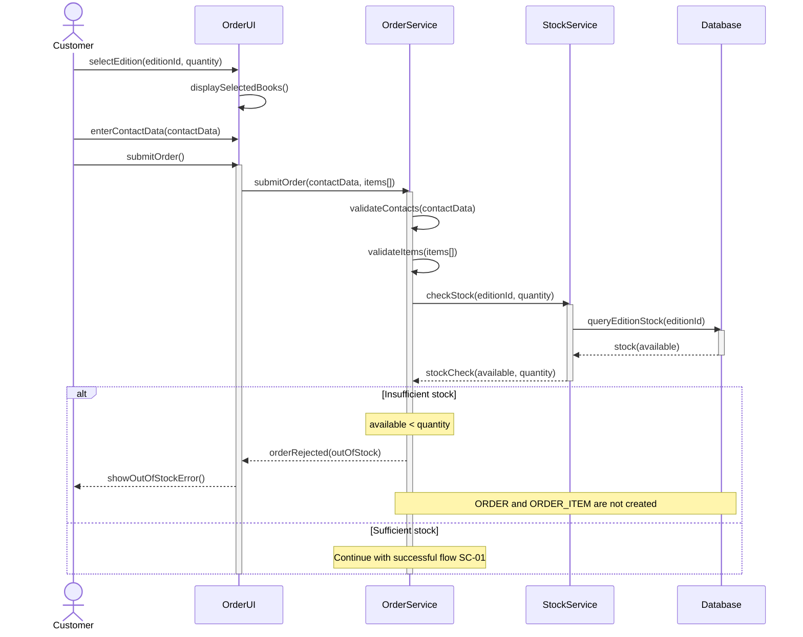

# Sequence Diagram — SC-02 Недостатній залишок

## Опис

Діаграма показує помилковий сценарій UC-04 із Завдання №2, коли покупець замовляє більше примірників видання, ніж є в наявності. Система перевіряє залишок та повертає відмову без створення замовлення.

## Діаграма

[Вихідний код Mermaid](https://github.com/LilG3ra/MAVPZ/blob/main/task-3-sequence-diagram/diagrams/SC-02.mmd)

[Відкрити Mermaid](https://mermaid.live/)

[Матриця трасування](../traceability.md) - ще не готово також

## Основні учасники

- Customer — обирає видання, вводить дані й намагається оформити замовлення.
- OrderUI — отримує запит покупця та відображає повідомлення про помилку.
- OrderService — перевіряє дані та вирішує, чи можливе оформлення.
- StockService — отримує відомості про доступну кількість примірників.
- Database — повертає залишок обраного EDITION.

## Основні кроки взаємодії

- Покупець вибирає видання, зазначає кількість та надсилає замовлення.
- OrderService перевіряє контакти та позиції через validateContacts() та validateItems().
- OrderService запитує у StockService доступний залишок.
- StockService отримує дані з Database й повертає результат перевірки.
- Якщо available менше quantity, OrderService відхиляє замовлення, а OrderUI повідомляє покупцеві про недостатній залишок.

## Зв'язки між учасниками

- OrderUI передає запит до OrderService.
- OrderService звертається до StockService, який читає залишок у Database.
- У фрагменті alt наведено дві умови: недостатній або достатній залишок; успішний шлях продовжується в SC-01.

## Основні бізнес-правила

- Замовлена кількість не може перевищувати доступний залишок EDITION.
- За недостатнього залишку ORDER та ORDER_ITEM не створюються.
- Відмова повинна бути повідомлена покупцеві.
- Обов’язкова реєстрація для оформлення не потрібна.

## Висновок

SC-02 показує перевірку наявності примірників і відмову в оформленні замовлення за недостатнього залишку. Цей кейс - це помилкова альтернатива успішному SC-01.
