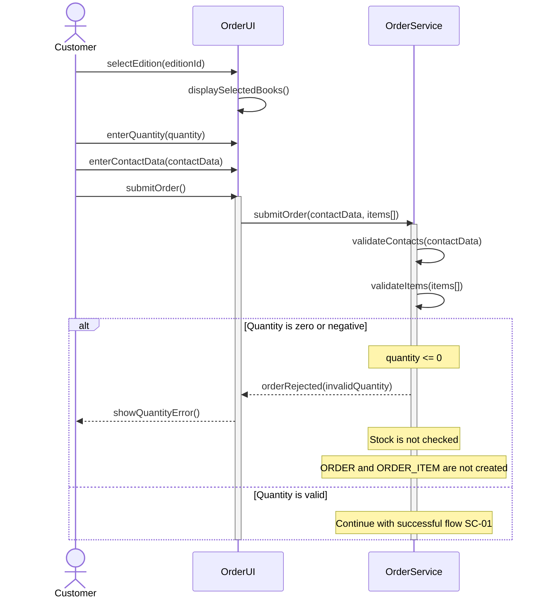

# Sequence Diagram — SC-03 Недопустима кількість

## Опис

Діаграма відображає відхилення замовлення в UC-04 із Завдання №2, коли покупець вказує нульову або від’ємну кількість примірників. Помилка визначається на етапі валідації позицій.

## Діаграма

[Вихідний код Mermaid](https://github.com/LilG3ra/MAVPZ/blob/main/task-3-sequence-diagram/diagrams/SC-03.mmd)

[Відкрити Mermaid](https://mermaid.live/)

[Матриця трасування](https://github.com/LilG3ra/MAVPZ/blob/main/task-3-sequence-diagram/traceability.md) 

## Основні учасники

- Customer — вибирає видання, вводить кількість та надсилає замовлення.
- OrderUI — передає дані до сервісу та показує повідомлення про помилку.
- OrderService — перевіряє контакти й позиції замовлення, визначає недопустиму кількість.

## Основні кроки взаємодії

- Покупець вибирає видання, вводить кількість, заповнює контакти та надсилає замовлення.
- OrderUI передає запит до OrderService.
- OrderService виконує validateContacts() і validateItems().
- Фрагмент alt перевіряє, чи quantity менше або дорівнює нулю.
- За недопустимої кількості OrderService повертає invalidQuantity, а OrderUI показує помилку; перевірка залишків та створення замовлення не виконуються.

## Зв'язки між учасниками

- Покупець взаємодіє з OrderUI, який звертається до OrderService.
- StockService та Database відсутні, оскільки сценарій завершується під час валідації.
- Фрагмент alt відділяє помилкове значення кількості від допустимого, для якого існує SC-01.

## Основні бізнес-правила

- Кількість примірників у кожній позиції повинна бути > 0.
- Некоректна кількість не дозволяє оформлення замовлення.
- Після помилки залишки не перевіряються, ORDER та ORDER_ITEM не створюються.

## Висновок

SC-03 деталізує перевірку кількості примірників і демонструє відмову в оформленні за порушення бізнес-правила quantity > 0.
