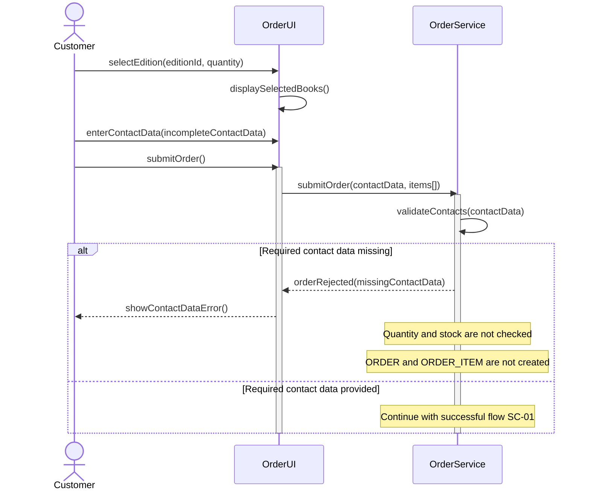

# Sequence Diagram — SC-04 Відсутність контактних даних

## Опис

Діаграма показує сценарій UC-04 із Завдання №2, у якому покупець намагається оформити замовлення без обов’язкової контактної інформації. Система відхиляє оформлення ще до перевірки кількості та залишків.

## Діаграма

[Вихідний код Mermaid](https://github.com/LilG3ra/MAVPZ/blob/main/task-3-sequence-diagram/diagrams/SC-04.mmd)

[Відкрити Mermaid](https://mermaid.live/)

[Матриця трасування](https://github.com/LilG3ra/MAVPZ/blob/main/task-3-sequence-diagram/traceability.md) 

## Основні учасники

- Customer — обирає видання й надсилає замовлення з неповними контактними даними.
- OrderUI — приймає запит та відображає повідомлення про відсутні дані.
- OrderService — перевіряє обов’язкові контактні дані й повертає результат.

## Основні кроки взаємодії

- Покупець обирає видання та намагається оформити замовлення з неповними контактними даними.
- OrderUI надсилає contactData та items[] до OrderService.
- OrderService виконує validateContacts(contactData).
- Фрагмент alt визначає чи є обов’язкові контактні дані.
- За їх відсутності OrderService повертає missingContactData, OrderUI виводить повідомлення про помилку.

## Зв'язки між учасниками

- Customer взаємодіє з OrderUI, який передає дані до OrderService.
- StockService та Database не залучаються, оскільки замовлення відхиляється до перевірки залишків.
- Фрагмент alt показує відсутні та надані контактні дані, а успішний шлях відсилає до SC-01.

## Основні бізнес-правила

- Контактні дані, визначені як обов’язкові у вимогах UC-04, потрібно заповнити.
- Реєстрація покупця не є обов’язковою.
- Без обов’язкових контактів замовлення не створюється, а перевірка залишків не виконується.

## Висновок

SC-04 деталізує перевірку контактних даних та відхилення оформлення без створення ORDER і ORDER_ITEM.
