# Activity Diagram — UC-04 Оформити замовлення

## Опис

Діаграма деталізує процес UC-04 (Оформити замовлення) онлайн-магазину друкованих книг без обов'язкової реєстрації покупця. Вона об'єднує SC-01–SC-04 у єдину модель поведінки: перевірка контактів, паралельна перевірка позицій і кількості, групування видань, перевірка залишків, транзакційне оформлення, підтвердження або відмова з можливістю повторної спроби.

## Діаграма

```mermaid
---
config:
  htmlLabels: false
  flowchart:
    wrappingWidth: 350
    nodeSpacing: 50
    rankSpacing: 60
    padding: 15
---
flowchart TD
    START((Початок)) --> C1["Customer:<br/>selectEditions(editions[], quantities[])<br/>Оформлення без реєстрації"]
    C1 --> UI1["OrderUI:<br/>displaySelectedBooks()"]
    UI1 --> C0["Customer:<br/>enterContactData(contactData)"]
    C0 --> C2["Customer · Send Signal<br/>submitOrder()"]
    C2 --> UI2["OrderUI · Accept Event<br/>submitOrder()"]
    UI2 --> OS1["OrderUI → OrderService<br/>submitOrder(contactData, items[])"]
    OS1 --> OS2["OrderService:<br/>validateContacts(contactData)"]
    OS2 --> D1{"Обов'язкові контакти<br/>заповнено?"}
    D1 -->|Ні · SC-04| E1["OrderService:<br/>reason = missingContactData"]
    D1 -->|Так| V1["OrderService:<br/>validateItems(items[])"]

    V1 --> F1["FORK · AND"]
    F1 --> V2["OrderService:<br/>Перевірити наявність<br/>хоча б однієї позиції"]
    F1 --> V3["OrderService:<br/>Перевірити quantity ≥ 1<br/>для кожної позиції"]
    V2 --> J1["JOIN · AND<br/>Дочекатися обох результатів"]
    V3 --> J1
    J1 --> D2{"Є хоча б<br/>одна позиція?"}
    D2 -->|Ні| E2["OrderService:<br/>reason = emptyOrder<br/>Порожнє замовлення"]
    D2 -->|Так| D3{"Усі кількості<br/>допустимі?"}
    D3 -->|Ні · SC-03| E3["OrderService:<br/>reason = invalidQuantity<br/>Мінімальна кількість — 1"]
    D3 -->|Так| OS3["OrderService:<br/>aggregateItemsByEdition(items[])"]
    OS3 --> OS4["OrderService: для кожного EDITION<br/>checkStock(editionId, totalQuantity)<br/>→ StockService"]
    OS4 --> S1["StockService → Database<br/>queryEditionStock(editionId)"]
    S1 --> S2["Database → StockService: available<br/>StockService → OrderService:<br/>stockCheck(available, totalQuantity)"]
    S2 --> S3["OrderService:<br/>Зберегти результат перевірки<br/>та available за editionId"]
    S3 --> D4{"Є ще неперевірені<br/>видання?"}
    D4 -->|Так| OS4
    D4 -->|Ні| D5{"Усіх залишків<br/>достатньо?"}
    D5 -->|Ні · SC-02| E4["OrderService:<br/>reason = outOfStock<br/>available за editionId<br/>Для видань із нестачею"]
    D5 -->|Так| DB0["OrderService → Database<br/>createOrderAtomically(contactData, items[])"]

    DB0 --> DB1["Database:<br/>beginTransaction()<br/>Ініціалізувати локальний набір<br/>insufficientEditionIds"]
    DB1 --> D0{"Транзакцію<br/>розпочато?"}
    D0 -->|Ні| E5["Database → OrderService:<br/>reason = technicalError<br/>Транзакцію не розпочато"]
    D0 -->|Так| DB2["Database: для кожного EDITION<br/>lockEditionAndReadStockAndPrice()<br/>Перевірити сумарну кількість<br/>Зафіксувати priceSnapshot<br/>За нестачі додати editionId<br/>до insufficientEditionIds"]
    DB2 --> D6{"Читання та блокування<br/>успішні?"}
    D6 -->|Ні| RB2["Database: rollback()<br/>Database → OrderService:<br/>reason = technicalError"]
    D6 -->|Так| D7{"Є ще неперевірені<br/>видання?"}
    D7 -->|Так| DB2
    D7 -->|Ні| D8{"Усіх залишків у<br/>транзакції достатньо?"}
    D8 -->|Ні| RB1["Database:<br/>Зберегти insufficientEditionIds у пам'яті<br/>rollback()<br/>Database → OrderService:<br/>orderRejected(outOfStock,<br/>insufficientEditionIds)"]
    RB1 --> OS8["OrderService:<br/>Ініціалізувати порожній набір<br/>актуальних залишків"]
    OS8 --> OS5["OrderService → StockService:<br/>checkStock(editionId, totalQuantity)<br/>Для чергового ID з insufficientEditionIds<br/>StockService → Database:<br/>queryEditionStock(editionId)"]
    OS5 --> OS6["Database → StockService: available<br/>StockService → OrderService:<br/>stockCheck(available, totalQuantity)<br/>Зберегти актуальний available за editionId<br/>Позначити ID перевіреним"]
    OS6 --> D14{"Є ще ID для<br/>повторної перевірки?"}
    D14 -->|Так| OS5
    D14 -->|Ні| E4
    D8 -->|Так| DB3["Database:<br/>createOrderRecord(contactData)<br/>Отримати orderId"]
    DB3 --> D9{"ORDER створено<br/>без помилки?"}
    D9 -->|Ні| RB2

    D9 -->|Так| DB4["Database: для кожної позиції<br/>calculateItemTotal(quantity, priceSnapshot)<br/>createOrderItem(orderId, editionId,<br/>quantity, priceSnapshot)<br/>updateEditionStock(editionId, quantity)"]
    DB4 --> D10{"Операції позиції<br/>успішні?"}
    D10 -->|Ні| RB2
    D10 -->|Так| D11{"Є ще позиції?"}
    D11 -->|Так| DB4
    D11 -->|Ні| DB5["Database:<br/>commit()"]
    DB5 --> D12{"Транзакцію успішно<br/>збережено?"}
    D12 -->|Ні · підтверджено незбереження| RB2
    D12 -->|Так · SC-01| DB6["Database → OrderService<br/>orderCreated(orderId, savedItems[])"]

    DB6 --> OS7["OrderService:<br/>initializeOrderSummary(orderId)<br/>Для кожного savedItem:<br/>addItemToSummary()<br/>quantity, priceSnapshot, itemTotal"]
    OS7 --> OK1["OrderService · Send Signal<br/>orderCreated(orderId, summary)<br/>→ OrderUI"]
    OK1 --> OK2["OrderUI · Accept Event<br/>orderCreated(orderId, summary)"]
    OK2 --> OK3["OrderUI · Send Signal<br/>confirmationMessage(orderId, summary)<br/>→ Customer"]
    OK3 --> OK4["Customer · Accept Event<br/>Отримати підтвердження<br/>та підсумок замовлення"]
    OK4 --> END((Кінець))

    E1 --> REJ1
    E2 --> REJ1
    E3 --> REJ1
    E4 --> REJ1
    RB2 --> REJ1
    E5 --> REJ1
    REJ1["OrderService · Send Signal<br/>orderRejected(reason, available за потреби)<br/>→ OrderUI"] --> REJ2["OrderUI · Accept Event<br/>orderRejected(reason, available за потреби)"]

    REJ2 --> REJ3{"Причина відмови<br/>reason?"}
    REJ3 -->|missingContactData| MSG1["OrderUI · Send Signal → Customer<br/>showContactDataError()<br/>Заповніть обов'язкові контакти"]
    REJ3 -->|invalidQuantity| MSG2["OrderUI · Send Signal → Customer<br/>showQuantityError()<br/>Мінімальна кількість — 1"]
    REJ3 -->|outOfStock| MSG3["OrderUI · Send Signal → Customer<br/>showOutOfStockError(available)<br/>showQuantityChangeOption()"]
    REJ3 -->|emptyOrder| MSG4["OrderUI · Send Signal → Customer<br/>Повідомлення про порожнє замовлення"]
    REJ3 -->|technicalError| MSG5["OrderUI · Send Signal → Customer<br/>Повідомлення про технічну помилку"]
    MSG1 --> REJ4["Customer · Accept Event<br/>Отримати відповідне повідомлення<br/>про помилку"]
    MSG2 --> REJ4
    MSG3 --> REJ4
    MSG4 --> REJ4
    MSG5 --> REJ4

    REJ4 --> D13{"Повторити<br/>оформлення?"}
    D13 -->|Так · виправити дані за потреби| C1
    D13 -->|Ні| CANCEL["Customer:<br/>Припинити оформлення"]
    CANCEL --> END

    classDef customer fill:#e8f1ff,stroke:#4777a8,color:#16324e;
    classDef ui fill:#eaf7f7,stroke:#4f8f90,color:#173d40;
    classDef service fill:#f1f0fb,stroke:#8175b4,color:#312852;
    classDef db fill:#f1f4f7,stroke:#687b8d,color:#263746;
    classDef stock fill:#fff4dc,stroke:#b38a37,color:#4f3b12;
    classDef decision fill:#fff8e9,stroke:#b5944f,color:#493a18;
    classDef error fill:#fcebed,stroke:#b96a72,color:#642e36;
    classDef sync fill:#46566a,stroke:#46566a,color:#ffffff;
    classDef terminal fill:#e8f2eb,stroke:#527c5d,color:#24452d;
    class C1,C0,C2,OK4,REJ4,CANCEL customer;
    class UI1,UI2,OS1,OK2,OK3,REJ2,MSG1,MSG2,MSG3,MSG4,MSG5 ui;
    class OS2,V1,V2,V3,OS3,OS4,S3,DB0,OS5,OS6,OS7,OS8,OK1,REJ1 service;
    class S1,S2 stock;
    class DB1,DB2,DB3,DB4,DB5,DB6 db;
    class D0,D1,D2,D3,D4,D5,D6,D7,D8,D9,D10,D11,D12,D13,D14,REJ3 decision;
    class E1,E2,E3,E4,E5,RB1,RB2 error;
    class F1,J1 sync;
    class START,END terminal;
```

[Вихідний код Mermaid](UC-04-activity.mmd) · [Mermaid Live](https://mermaid.live/)

## Учасники та позначення

- Customer — обирає видання, надає дані, отримує повідомлення та вирішує, чи повторити спробу.
- OrderUI — приймає запит і відображає результат.
- OrderService — валідує дані, групує позиції, координує перевірки та формує підсумок.
- StockService — перевіряє залишки EDITION через Database.
- Database — читає дані, блокує видання в транзакції, створює ORDER і ORDER_ITEM, оновлює залишки та виконує commit()/rollback().

Ромби — умовні переходи; прямокутники — дії; FORK/JOIN із позначенням AND — паралельне виконання двох перевірок і очікування обох результатів. Send Signal / Accept Event — явні дії надсилання й отримання повідомлень; стрілки між ними відображають продовження процесу після отримання. Це домовленості Mermaid Flowchart, а не окрема нотація UML чи BPMN.

## Покриття сценаріїв

| Сценарій | Основні вузли | Результат |
|---|---|---|
| SC-01 / UC04-S01 | D1–D12, DB3–DB6, OK1–OK4 | Створення замовлення та підтвердження після commit() |
| SC-02 / UC04-S02 | D5, E4, REJ1–REJ3, MSG3, REJ4 | Відмова з доступною кількістю та можливістю її змінити |
| SC-03 / UC04-S03 | D3, E3, REJ1–REJ3, MSG2, REJ4 | Відмова, повідомлення про мінімальну кількість 1 |
| SC-04 / UC04-S04 | D1, E1, REJ1–REJ3, MSG1, REJ4 | Відмова до validateItems() та перевірки залишків |
| FR-08 | D2, E2, REJ3, MSG4 | Порожнє замовлення відхилено |
| Конфлікт залишків у транзакції | D8, RB1, OS8, OS5, OS6, D14, E4, MSG3 | Rollback, повторне читання залишків і повідомлення покупцеві |
| Технічна помилка | D0/D6/D9/D10/D12, E5/RB2, REJ3, MSG5 | Відмова без часткових змін; rollback для відкритої транзакції |

## Джерела та межі

- [ER-модель Завдання №1](https://github.com/LilG3ra/MAVPZ/blob/main/task-1-domain-er/diagrams/er-model.md)
- [Use Cases Завдання №2](https://github.com/LilG3ra/MAVPZ/blob/main/task-2-requirements-use-case/diagrams/UC.md)
- [Функціональні вимоги FR-07–FR-15](https://github.com/LilG3ra/MAVPZ/blob/main/task-2-requirements-use-case/requirements/functional.md)
- [Gherkin UC04-S01–UC04-S04](https://github.com/LilG3ra/MAVPZ/blob/main/task-2-requirements-use-case/scenarios/UC-04-order-scenario.md)
- [Sequence Diagram Завдання №3](https://github.com/LilG3ra/MAVPZ/tree/main/task-3-sequence-diagram/diagrams)
- [Специфікація Завдання №4](https://github.com/LilG3ra/MAVPZ/blob/main/task-4-process-behavior/spec.md)

Уточнення специфікації №4: пріоритет перевірки контактів, паралельна валідація позицій, повторна спроба, отримання актуального залишку після rollback. У UC04-S03 припускається, що контакти заповнено, інакше пріоритет має SC-04. У разі одночасно порожнього замовлення та некоректної кількості першою обробляється відсутність позицій. Технічна відмова commit() у моделі означає підтверджене незбереження; невідомий результат commit() не визначено у вхідних вимогах та не моделюється. Назви помилок для порожнього замовлення та технічного збою не стандартизовані попередніми діаграмами. Уточнено передавання insufficientEditionIds після rollback() і вибір повідомлення залежно від reason. Попередні завдання не змінюються.
